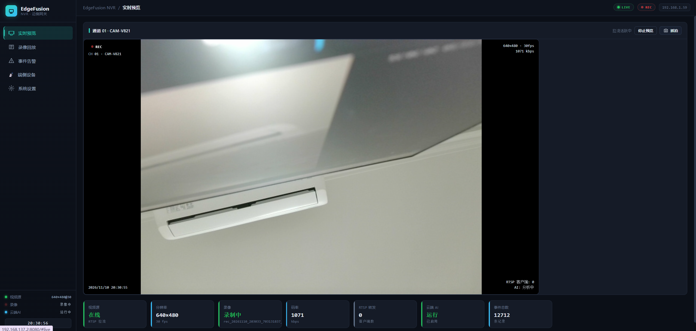
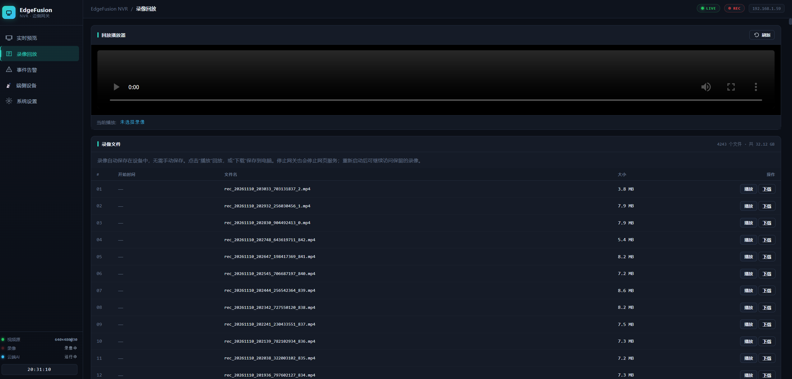
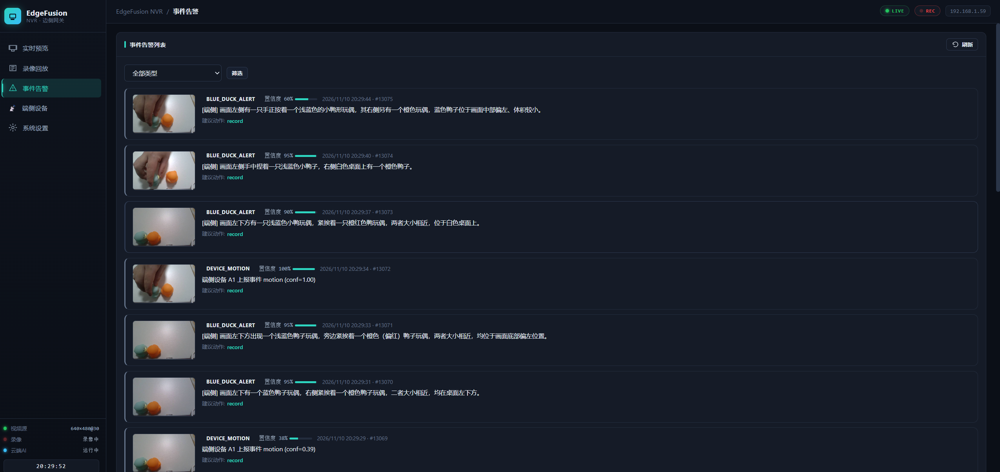
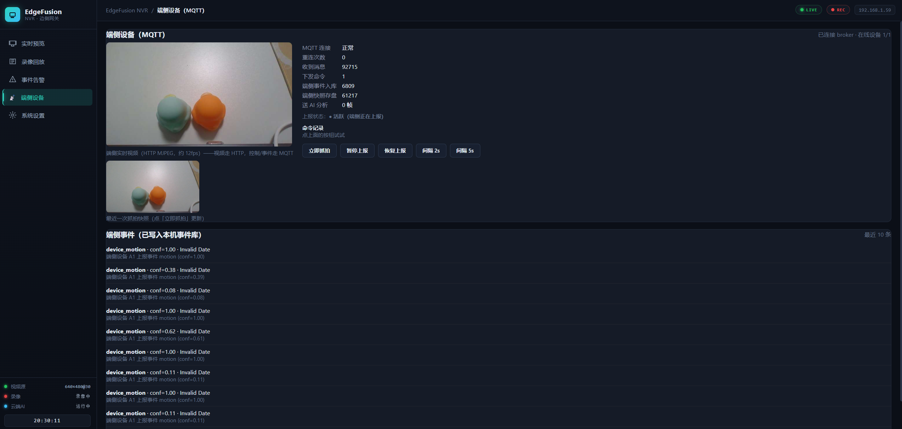
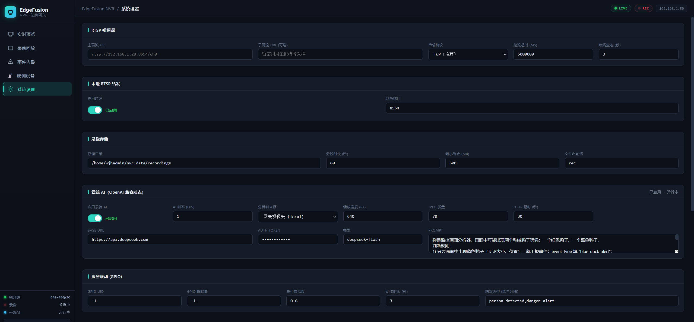

# EdgeFusion — 云边端协同智能 NVR

基于 **RK3576（DshanPi-A1）+ USB 摄像头 + PC 端侧代理**的视频监控与智能分析项目。网关使用 C 与 POSIX 多线程实现视频采集、分段录像、Web 管理和 RTSP 转发；通过 MQTT 接入端侧设备，并支持**云端视觉模型分析**与**板端 RKNN/NPU 推理**，将识别结果、置信度和证据图汇入统一事件中心。

```text
PC 端侧摄像头
  ├─ Python agent → MQTT 状态 / 事件 / JPEG 快照 ───────┐
  │                 ← 抓拍 / 暂停 / 恢复 / 间隔命令   │
  └─ HTTP MJPEG → 浏览器「端侧设备」页                 │
                                                     ▼
RK3576 网关                                Mosquitto Broker
  USB 摄像头 → V4L2 → MJPEG 解码 → H.264 软件编码     ↕
                                  ├─ MP4 分段录像   C 网关
                                  └─ 有界队列 → RTSP 转发
  相机原始 JPEG → 预览缓存 → Web 实时预览 / 抓拍
                       ├─ 云端 AI（也可分析端侧快照）
                       └─ 独立 RKNN/NPU 推理进程
                                    ↓
                           SQLite 事件库 + 证据图
                                    ↓
                         Web 事件告警 / GPIO 联动
```

> 网关每次选择一路 USB 或 RTSP 视频源进行录像和转发。PC 端侧画面单独通过 HTTP 展示；两路画面可供云端 AI 分析，不代表两路都进入网关录像。

---

## 1. 核心能力

| 模块 | 已实现功能 |
|------|------------|
| 视频采集 | V4L2 USB MJPEG 采集，`ioctl + mmap + poll` 缓冲轮转；支持配置切换为 RTSP 输入 |
| 视频编码 | FFmpeg 解码与格式转换、libx264 H.264 软件编码；修正录像时间基、分段时间戳与色彩范围处理 |
| 本地录像 | fragmented MP4 分段、网页回放与下载、低空间清理、默认最近 3 天保留 |
| 实时预览 | USB 路径直接缓存相机 JPEG，提供 MJPEG 预览、OSD、抓拍及运行指标 |
| RTSP 转发 | H.264 转发，多客户端连接、每客户端有界发送队列、非阻塞发送 |
| 端侧设备 | MQTT 心跳、在线状态、移动事件、快照上报，以及网页命令下发 |
| 云端 AI | OpenAI 兼容视觉接口，自定义 Prompt，支持 `local / device / both` 分析来源 |
| 板端 NPU | 独立 RKNN 推理服务，支持 YOLOv5 与 YOLO11/YOLOv8 输出布局解码，将检测事件及图片回灌网关 |
| 事件管理 | SQLite 入库、证据图、类型筛选、置信度与文字描述；可配置 GPIO 报警条件 |
| 运行维护 | systemd 开机启动、异常退出重启、信号退出收尾，以及队列/录像/MQTT 等测试与采样工具 |

录像到期检查在启动时及运行期间每 60 秒执行，跳过正在写入的片段。低空间清理可能提前删除最旧录像，因此“3 天”是最长保留时间，不是最低保证。

---

## 2. 界面预览

以下截图来自实际演示环境；其中的 IP、通道名称、模型配置和统计值仅代表截图时的状态，部署时以实际配置为准。

### 实时预览

查看网关摄像头画面、录像状态、分辨率、码率、RTSP 客户端数和事件总数，并支持抓拍。



### 录像回放

录像自动分段保存，可在列表中选择播放或下载到电脑。



### 事件告警

统一展示云端识别、端侧移动检测和 NPU 检测事件。图中 `BLUE_DUCK_ALERT` 是自定义 Prompt 场景的示例。



### 端侧设备

显示 PC 摄像头实时视频、最近快照、MQTT 指标和端侧事件；提供立即抓拍、暂停/恢复上报与间隔控制。



### 系统设置

配置视频服务、录像存储、云端 AI 与 GPIO 联动。USB 设备节点、采集参数等仍通过配置文件设置。



---

## 3. 仓库结构

```text
EdgeFusion_Smart_NVR/
├── edgefusion_gateway/      # RK3576 C 网关、Web 前端、配置与测试
│   ├── src/                 # 采集、录像、队列、RTSP、MQTT、AI、事件与 HTTP
│   ├── web/                 # 五个管理页面
│   ├── scripts/             # 启动、服务安装、NPU 推理与验证工具
│   ├── config/              # RK3576 USB 基础配置
│   └── Makefile.native      # 板端原生构建
├── edgefusion_vision/
│   └── device_agent/        # PC 摄像头代理：MQTT + HTTP MJPEG
├── docs/                    # 项目展示资源
│   └── images/              # README 界面截图
└── LICENSE
```

模块说明：[网关 README](edgefusion_gateway/README.md) · [端侧 README](edgefusion_vision/README.md)。

---

## 4. 运行环境

| 设备 / 组件 | 用途 |
|-------------|------|
| DshanPi-A1 / RK3576，Linux（Ubuntu / Armbian） | C 网关与可选 NPU 推理服务 |
| 支持 MJPEG 的 USB 摄像头 | 网关本地视频源，当前演示为 640×480 |
| Windows PC + 摄像头 + Python | 端侧设备代理与浏览器 |
| Mosquitto | 独立 MQTT Broker，连接网关与端侧代理 |
| OpenAI 兼容的视觉模型服务（可选） | 云端画面分析，需支持图像输入 |
| RKNN 模型及板端运行环境（可选） | 本地离线目标检测 |

---

## 5. 快速开始

### 5.1 编译网关（RK3576 板端）

```bash
sudo apt install build-essential pkg-config ffmpeg v4l-utils \
  libavformat-dev libavcodec-dev libavutil-dev libswscale-dev libswresample-dev \
  libcurl4-openssl-dev libssl-dev libsqlite3-dev libjson-c-dev zlib1g-dev

cd ~/Program/EdgeFusion_Smart_NVR/edgefusion_gateway
make -f Makefile.native -j2
v4l2-ctl --list-devices
```

编辑 `config/rk3576-usb.conf`，将 `video_device` 改为实际支持 MJPEG 的设备节点，并确认录像目录可写。基础配置默认关闭云端 AI、MQTT 和 RTSP 转发，可先验证本地录像与预览。

### 5.2 启动与访问（RK3576 板端）

```bash
bash scripts/run-usb.sh
```

浏览器访问 `http://<网关IP>:8080`。停止前台网关使用 `Ctrl+C`。

需要开机自启时，先结束前台实例，再执行：

```bash
bash scripts/install-service.sh
systemctl status edgefusion-gateway --no-pager
journalctl -u edgefusion-gateway -f
```

安装脚本默认使用仓库内 `config/rk3576-usb.conf`。现有演示部署使用的 `~/nvr-data/gw.conf` 是另一份配置；已有服务请先用 `systemctl cat edgefusion-gateway` 核对 `ExecStart`，不要混用两份配置或启动两个实例。

### 5.3 接入端侧摄像头（Windows PC）

先按[网关 MQTT 配置说明](edgefusion_gateway/README.md#5-mqtt-端侧接入)启动 Broker，并启用网关 MQTT。然后在 PC PowerShell 执行：

```powershell
cd Z:\Program\EdgeFusion_Smart_NVR\edgefusion_vision\device_agent
python -m pip install opencv-python numpy paho-mqtt
python mqtt_device_agent.py --broker 192.168.137.2 --device A1
```

将示例 IP 改为实际网关地址，在网页「端侧设备」查看画面和上报状态。

### 5.4 开启智能分析

- **云端 AI**：在「系统设置」填写视觉模型接口、Token、模型名和 Prompt，选择分析来源，再启用。自定义事件可用于人物或蓝色鸭子等演示场景。
- **板端 NPU**：准备 RK3576 对应的 RKNN 模型及 RKNNLite 环境，独立启动推理服务，详见[网关 README](edgefusion_gateway/README.md#6-云端-ai-与板端-npu)。

---

## 6. 验证与功能边界

板端验证入口：

```bash
cd ~/Program/EdgeFusion_Smart_NVR/edgefusion_gateway
make -f Makefile.native test
make -f Makefile.native test-web test-events
curl -fsS http://127.0.0.1:8080/api/status
```

- USB 视频编码当前采用 **libx264 软件编码**，不应描述为 MPP 硬编码或零拷贝链路。
- NPU 服务当前从网关 `/api/snapshot` 取帧；云端 AI 的 `local/device/both` 不等于 NPU 也支持相同来源切换。
- `suggested_action` 是事件描述中的建议，不会自动触发录像或消息通知；录像随网关视频链路运行。GPIO 动作需配置引脚、事件类型及置信度条件。
- MQTT 当前演示采用局域网匿名连接，未实现 TLS、设备鉴权和 QoS2；多设备规模化接入尚未验证。
- 真实摄像头拔插、长时间组合故障测试及慢客户端踢出触发仍有验证边界，不作为已完成的稳定性保证。

---

## 7. 模块使用说明

| 说明 | 内容 |
|------|------|
| [网关部署与运行](edgefusion_gateway/README.md) | 编译、视频源、录像、RTSP、MQTT、云端 AI 与 NPU |
| [端侧代理与控制](edgefusion_vision/README.md) | PC 摄像头代理、HTTP 视频、MQTT 主题与命令 |

---
## 8. 许可证

见 [LICENSE](LICENSE)。
