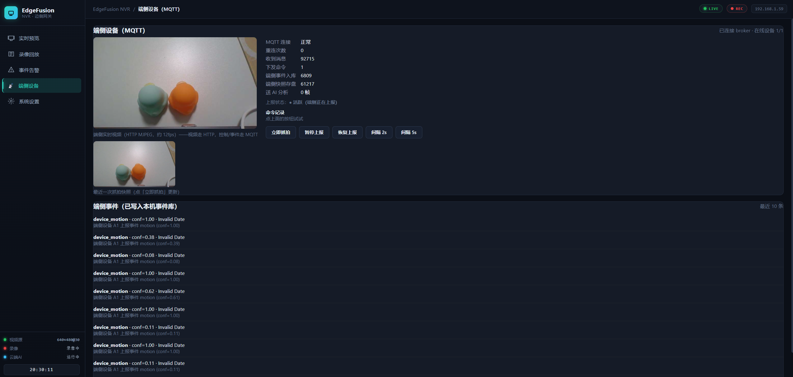

# EdgeFusion Vision（端侧摄像头代理）

当前演示使用 **PC 摄像头 + Python agent** 作为端侧设备：OpenCV 采集画面 → HTTP MJPEG 实时视频；同时通过 MQTT 上报心跳、移动事件和 JPEG 快照，并执行网关下发的抓拍、暂停、恢复及参数调整命令。

网关运行在 RK3576 上，负责事件存储、Web 管理与可选云端分析。整体架构见[项目首页](../README.md)，网关部署见[网关 README](../edgefusion_gateway/README.md)。

---

## 1. 核心能力

| 功能 | 实现 |
|------|------|
| 摄像头采集 | OpenCV 打开 PC 摄像头，设备序号和期望分辨率可配置 |
| 实时视频 | HTTP MJPEG 服务，默认 8081 端口；浏览器直接访问 PC |
| 在线状态 | 周期 MQTT 心跳、保留状态消息、LWT 异常离线通知 |
| 移动检测 | 基于画面变化的移动检测，支持阈值与事件冷却配置 |
| 周期快照 | JPEG 压缩后通过 MQTT 上报，默认每 5 秒一次 |
| 命令抓拍 | 收到 `snapshot` 命令立即上报快照 |
| 远程控制 | 暂停/恢复、调整快照间隔及移动阈值、停止代理 |
| 网关集成 | 端侧事件入库，快照可送云端 AI；网页展示视频、快照和运行指标 |

```text
PC 摄像头 → OpenCV → 最新画面
                      ├─ HTTP MJPEG → 浏览器「端侧设备」
                      ├─ 移动检测 → MQTT event ──┐
                      ├─ JPEG → MQTT snapshot ──┤
                      └─ 心跳 → MQTT status ────┤
                                                ▼
                                         Mosquitto Broker
                                                ↕
                                           RK3576 网关
                                                │
                                     Web 命令 → MQTT cmd
```

MQTT 承载状态、事件、快照及控制消息，实时视频走 HTTP。端侧视频不会自动转成网关 RTSP 输出，也不自动录入网关 MP4。

---

## 2. 目录结构

```text
edgefusion_vision/
├── device_agent/
│   └── mqtt_device_agent.py  # 当前 PC 端侧代理入口
├── sample/                  # V821 RTSP 示例代码
├── aw_pack_src/             # V821 多媒体库与头文件
├── share_lib/               # 对应平台运行库
├── config/                  # 平台配置
├── output/                  # 平台构建产物
├── Makefile                 # V821 平台构建入口
└── build.sh                 # V821 平台构建脚本
```

当前 RK3576 + PC 演示使用 `device_agent/`；同目录中的 V821 平台代码不是 PC 代理的依赖，也不需要为此执行 `build.sh`。本说明以当前端侧代理为使用入口。

---

## 3. 环境与启动

### 3.1 前置条件

- PC 有可用摄像头与 Python 环境。
- PC、网关和浏览器能够通过局域网互相访问。
- Broker 已启动并允许 PC 连接；网关配置 `mqtt_enable=1`，主题前缀为 `edgefusion/device`。
- 当前演示使用设备 ID `A1`，网关网页也以该设备为主要控制对象。

### 3.2 安装依赖（Windows PowerShell）

```powershell
cd Z:\Program\EdgeFusion_Smart_NVR\edgefusion_vision\device_agent
python -m pip install opencv-python numpy paho-mqtt
```

Z 盘仅为示例工程位置；也可将代理脚本放在 PC 本地运行。

### 3.3 启动代理

```powershell
python mqtt_device_agent.py --broker 192.168.137.2 --device A1 --camera 0
```

将 IP 改为实际 Broker 地址。保留运行窗口；首次出现防火墙提示时，允许可信专用网络访问 Python 的 HTTP 服务。

启动后应看到 Broker 连接信息和 HTTP 视频地址：

- PC 本机可访问 `http://127.0.0.1:8081/`。
- 其他设备需访问 `http://<PC局域网IP>:8081/`。
- 网关网页「端侧设备」应显示在线状态、实时画面和最近快照。

按 `Ctrl+C` 正常退出时，代理主动上报离线并释放摄像头；异常掉线时由 Broker 根据 MQTT LWT 发布离线状态。

---

## 4. 常用启动参数

| 参数 | 默认值 | 说明 |
|------|--------|------|
| `--broker` | `192.168.137.2` | Broker 地址 |
| `--port` | `1883` | MQTT 端口 |
| `--device` | `A1` | 设备标识 |
| `--camera` | `0` | OpenCV 摄像头序号 |
| `--width` / `--height` | `1280` / `720` | 请求采集尺寸，实际取决于设备协商 |
| `--stream-width` | `640` | HTTP 视频缩放宽度 |
| `--http-port` | `8081` | HTTP MJPEG 端口 |
| `--snapshot-width` | `640` | MQTT 快照缩放宽度 |
| `--snapshot-interval` | `5` | 周期快照间隔，秒 |
| `--status-interval` | `5` | 状态心跳间隔，秒 |
| `--motion-ratio` | `0.01` | 移动检测阈值 |
| `--event-cooldown` | `5` | 移动事件冷却时间，秒 |

示例：使用第二个摄像头，每 2 秒上传一张快照：

```powershell
python mqtt_device_agent.py --broker 192.168.137.2 --device A1 --camera 1 --snapshot-interval 2
```

---

## 5. MQTT 协议与控制

### 5.1 主题约定

| 方向 | 主题 | 内容 |
|------|------|------|
| 端 → 网关 | `edgefusion/device/A1/status` | JSON 在线状态、设备信息及暂停状态；保留消息 |
| 端 → 网关 | `edgefusion/device/A1/event` | JSON 移动事件，QoS1 |
| 端 → 网关 | `edgefusion/device/A1/snapshot` | JPEG 二进制，QoS0 |
| 网关 → 端 | `edgefusion/device/A1/cmd` | JSON 控制命令 |

设备 ID 变化时，主题中的 `A1` 随之变化。主题可区分不同设备，但当前网页与验证以单设备为主，不代表已完成多设备管理。

### 5.2 命令格式

| 命令 | JSON 示例 | 行为 |
|------|-----------|------|
| 抓拍 | `{"cmd":"snapshot"}` | 立即上报当前画面 |
| 修改快照间隔 | `{"cmd":"set_snapshot_interval","value":2}` | 改为 2 秒，命令值最小 1 秒 |
| 修改移动阈值 | `{"cmd":"set_motion_ratio","value":0.02}` | 更新移动检测阈值 |
| 暂停 | `{"cmd":"pause"}` | 暂停周期快照和移动事件 |
| 恢复 | `{"cmd":"resume"}` | 恢复周期快照和移动事件 |
| 停止 | `{"cmd":"stop"}` | 结束代理循环 |

暂停后心跳和 HTTP 视频继续，命令抓拍仍可执行。参数调整保存在进程内，重新启动后使用命令行参数。

网页提供常用控制按钮；也可从板端经网关接口下发：

```bash
curl -fsS -X POST http://127.0.0.1:8080/api/mqtt/cmd \
  -H 'Content-Type: application/json' \
  -d '{"device":"A1","cmd":"set_snapshot_interval","value":2}'
```

---

## 6. 网关展示与 AI 分析



- 「端侧设备」显示实时视频、最近快照、消息统计、命令反馈与端侧事件。
- 移动检测事件进入网关事件库，以 `device_motion` 等类型展示。
- 网关云端 AI 设置为 `device` 或 `both` 时，可消费端侧上报快照并生成语义识别事件。
- 移动检测仅判断画面变化；蓝色鸭子等语义识别来自网关调用的视觉模型，不能归为端侧移动算法的能力。
- 当前 NPU 实时服务从网关本地截图接口取帧，端侧快照没有自动持续送入该服务的完整链路。

---

## 7. 常见问题

| 现象 | 排查方向 |
|------|----------|
| 摄像头打不开 | 检查系统摄像头权限、是否被其他软件占用，尝试 `--camera 1` |
| Broker 连接失败 | 检查实际 IP、1883 监听、防火墙及局域网连通性 |
| MQTT 正常但无实时画面 | HTTP 视频是独立链路；检查 PC 的 IP、8081 端口与防火墙 |
| 网关事件列表有移动事件但无新快照 | 检查是否暂停、快照间隔及端侧日志 |
| 频繁移动告警 | 调整 `--motion-ratio` 和 `--event-cooldown`，观察光照与背景变化 |
| 网页下发命令无响应 | 核对设备 ID、主题前缀、Broker 和代理连接状态 |
| 设备离线未立即显示 | 正常退出会主动报离线；异常掉线检测取决于 Broker 的连接与心跳判定 |

当前代理使用匿名 MQTT，不提供 TLS 与设备认证；主要用于局域网单设备功能演示。网关配置与启动方法见[网关 README](../edgefusion_gateway/README.md)。
